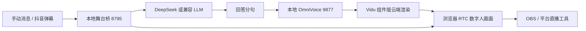

# 小雅数字人：从零安装到直播工作台

一份面向 Windows 新手的逐步教程：环境安装 → 本地 OmniVoice → FlashInfer / CUDA Graph → 语音与形象配置 → Vidu 组件版 → 银白直播工作台 → 抖音弹幕与 OBS。另附 DSH 语音插件和 DUIX 本地数字人的完整可选路线。

**这是个人整理的教程、安装脚本与界面补丁，不是上游官方发行版。** 数字人主程序来自 [cyber-xiaoya/cyber-xiaoya-live](https://github.com/cyber-xiaoya/cyber-xiaoya-live)，作者为天工开帧。许可证、修改说明及素材边界见 [THIRD_PARTY_NOTICES.md](THIRD_PARTY_NOTICES.md)。

整理日期：**2026-11-13**。基于一台 RTX 5060 Ti 16GB 电脑的实际搭建记录。依赖版本锁定在当时可工作的组合；其他显卡或将来的上游版本需要重新验证。安装脚本经过语法、配置保护、模型路径及补丁应用检查，**不是承诺所有电脑一键安装必成功**。验证范围见 [VALIDATION.md](VALIDATION.md)。

## 目录

- [先弄懂：你究竟在安装什么](#先弄懂你究竟在安装什么)
- [第 0 步：选路线、准备电脑](#第-0-步选路线准备电脑)
- [第 1 步：Windows 基础软件](#第-1-步windows-基础软件)
- [第 2 步：下载本教程](#第-2-步下载本教程)
- [第 3 步：安装 WSL2 和 Ubuntu](#第-3-步安装-wsl2-和-ubuntu)
- [第 4 步：让 Ubuntu 正常联网](#第-4-步让-ubuntu-正常联网)
- [第 5 步：部署本地 OmniVoice](#第-5-步部署本地-omnivoice)
- [第 6 步：找到或下载模型](#第-6-步找到或下载模型)
- [第 7 步：启动语音与验证加速](#第-7-步启动语音与验证加速)
- [第 8 步：安装直播工作台](#第-8-步安装直播工作台)
- [第 9 步：准备音色](#第-9-步准备音色)
- [第 10 步：填写 Vidu 和大模型配置](#第-10-步填写-vidu-和大模型配置)
- [第 11 步：按层验收后开始互动](#第-11-步按层验收后开始互动)
- [第 12 步：接入弹幕和直播软件](#第-12-步接入弹幕和直播软件)
- [以后每天怎么启动、怎么关闭](#以后每天怎么启动怎么关闭)
- [旧路线：DSH 插件与 DUIX](#旧路线dsh-插件与-duix)
- [文件地图与常见问题](#文件地图与常见问题)

## 先弄懂：你究竟在安装什么

| 名称 | 实际工作 | 是否在本地 | 当前直播路线是否需要 |
|---|---|---|---|
| WSL2 + Ubuntu | 在 Windows 中运行 Linux 环境 | 是 | 需要，运行语音模型 |
| NVIDIA 驱动 / PyTorch CUDA | 让模型使用显卡 | 是 | 需要 |
| OmniVoice | 文字变声音、参考音频克隆音色 | 是 | 需要 |
| FlashInfer | 加速 OmniVoice 的部分计算 | 是 | 推荐，先能出声再谈提速 |
| CUDA Graph | 进一步减少部分 GPU 调度开销，会占额外显存 | 是 | 可选，可关闭 |
| DeepSeek / 兼容 LLM API | 理解消息、生成回答 | 本教程默认是云端 API | 需要一种可用的 LLM 服务 |
| Vidu S2 组件版 | 根据本地音频及动作指令渲染数字人、推流 | 云端 | 当前工作台需要，通常计费 |
| 舞台桥与网页 | 对话、字幕、点播、动作、设置、录播 | 是 | 需要，端口 8795 |
| douyinLive + relay | 采集及转发抖音弹幕 | 是 | 可选 |
| OBS / 直播伴侣 | 把舞台画面推到直播平台 | 是 | 要开播时需要 |
| DSH + 8765 语音桥 | 早期网页聊天插件路线 | 是，但 LLM 可是云端 | 当前直播主线不需要 |
| Docker + DUIX | 在本地逐段生成口播视频 | 是 | 当前 Vidu 主线不需要 |

**“本地桥”不等于“大模型已本地部署”。** 本教程主线只有语音模型在本地，回复模型和人物渲染仍调用云端。若以后接本地 LLM，只要服务兼容 OpenAI Chat Completions，再更改 `llm.base_url/model/key_file`；本仓库不冒充已部署本地语言模型。



**不要把 Vidu realtime 全托管接口和 component 组件版接口混用。** 此工作台使用 `/live/s_avatar/component`，由本地调用 LLM 和 OmniVoice。你在另一个 Vidu Demo 里设置的云端语音，不会自动替换这里的本地音色。细节见 [05-vidu-stage.md](docs/05-vidu-stage.md)。

## 第 0 步：选路线、准备电脑

新手建议：**直接走本 README 的直播主线**。不用先装 Docker，不用先装 DSH 插件。等主线跑通，再按兴趣体验旧路线。

建议准备：

1. Windows 11 64 位、NVIDIA 显卡。本文脚本以 **RTX 5060 Ti / CUDA 13.0** 为目标；16GB 显存更从容，不保证 8GB 可用。
2. 系统内存建议 32GB。预留至少 40GB 空间用于环境、缓存、源码和模型；录播及可选 DUIX 镜像会额外占空间。
3. 能正常访问 GitHub、Hugging Face、Python 包源，以及你使用的 API 服务。
4. Vidu 账号、可用的组件版权限、API Key，以及一个准备好的数字人形象。
5. DeepSeek 或其他 OpenAI 兼容服务的 API Key。
6. 你自己录制或已获授权的清晰参考音频及其逐字文字。

### 先认清两种命令窗口

| 提示符例子 | 这是什么窗口 | 本文代码块 |
|---|---|---|
| `PS C:\...>` | Windows PowerShell | `powershell` |
| `user@PC:~$` | Ubuntu / Bash | `bash` |

复制代码时不要复制 `PS ...>` 或 `$` 提示符。本文所有 Windows 命令用 `pnpm.cmd` / 完整 Python 路径等形式，避免 PowerShell 把同名 `.ps1` 当作入口；不需要把系统执行策略永久改成无限制。

## 第 1 步：Windows 基础软件

**在哪里：Windows PowerShell。** 先逐条检查：

```powershell
git --version
python --version
ffmpeg -version
nvidia-smi
```

缺什么装什么。可用系统自带的 `winget`，安装后关闭并重开 PowerShell，使 PATH 生效：

```powershell
winget install --id Git.Git --exact
winget install --id Python.Python.3.12 --exact
winget install --id Gyan.FFmpeg --exact
```

再安装 Python 管理工具：

```powershell
python -m pip install uv
uv --version
```

如果 `python` 打开微软商店，用 `py -3.12 --version` 检查真正的 Python；重新安装时勾选添加 PATH。NVIDIA 驱动从 [NVIDIA 官方驱动页](https://www.nvidia.com/Download/index.aspx)安装，装好后 `nvidia-smi` 应能显示显卡。

**成功标志：** 上面的版本命令都有输出，`nvidia-smi` 能看到显卡。此时还没有启动任何模型。

## 第 2 步：下载本教程

**在哪里：Windows PowerShell。** 以下是本教程仓库地址；如果使用自己的 fork，改成你的仓库地址：

```powershell
New-Item -ItemType Directory -Path C:\AI -Force
cd C:\AI
git clone https://github.com/FanZhenyu36/xiaoya-live-deploy-guide.git
cd C:\AI\xiaoya-live-deploy-guide
```

也可在本仓库点击绿色 **Code → Download ZIP**，解压到 `C:\AI\xiaoya-live-deploy-guide`。注意不是在压缩包预览里运行脚本。

本教程采用两块目录：

```text
C:\AI\xiaoya-live-deploy-guide\   教程、模板、安装脚本（可以公开）
C:\AI\xiaoya-runtime\           运行程序、Key、音色、日志（不要上传）
```

推荐先用默认目录，跑通后再改。要改路径，复制设置模板：

```powershell
Copy-Item .\settings.example.json .\settings.local.json
notepad .\settings.local.json
```

JSON 路径可以写 `C:/AI/...`，不要写未经转义的 `C:\AI\...` 单反斜杠字符串。`settings.local.json` 被 Git 忽略。

## 第 3 步：安装 WSL2 和 Ubuntu

**在哪里：以管理员身份打开 Windows PowerShell。**

```powershell
wsl --install -d Ubuntu-22.04
```

按提示重启电脑。首次打开 Ubuntu 时创建一个 Linux 用户名和密码；输入密码不会显示星号，正常输入后回车。这个密码不是 Windows 密码。

重启后检查：

```powershell
wsl --list --verbose
wsl --update
```

`Ubuntu-22.04` 后面的 VERSION 应为 `2`。如果是 `1`：

```powershell
wsl --set-version Ubuntu-22.04 2
```

进入 Ubuntu：

```powershell
wsl -d Ubuntu-22.04
```

**下面开始是在 Ubuntu 里执行：**

```bash
sudo apt update
sudo apt install -y git ffmpeg curl build-essential python3-dev
nvidia-smi
```

**成功标志：** Ubuntu 里的 `nvidia-smi` 同样能看到显卡。WSL GPU 依赖 Windows 的 NVIDIA 驱动；不要为了本文再往 Ubuntu 装一套 Linux 显卡驱动。官方说明见 [NVIDIA CUDA on WSL](https://docs.nvidia.com/cuda/wsl-user-guide/index.html)。

## 第 4 步：让 Ubuntu 正常联网

**在哪里：Ubuntu。**

```bash
curl -I --connect-timeout 10 --max-time 30 https://github.com
curl -I --connect-timeout 10 --max-time 30 https://raw.githubusercontent.com
```

`raw.githubusercontent.com` 根地址返回 `301` 是正常跳转；证明请求有响应，**不代表某个文件已下载成功**。下载文件要用完整 URL，并检查状态和内容。

如果 Windows 走代理但 Ubuntu 不通，先看 [02-network.md](docs/02-network.md)。教程提供镜像网络 / 自动代理、NAT 下连接宿主机代理、DNS 返回 `0.0.0.0` 的排查步骤。

**不要直接照抄别人代理端口。** 在你自己的 VPN/代理软件里查看 HTTP 或 mixed 端口。SOCKS 端口和 HTTP 端口不是一回事。

**成功标志：** GitHub 与模型源可访问；本地 `127.0.0.1` 流量绕过代理。没通过这一步，先别开始大规模装包。

## 第 5 步：部署本地 OmniVoice

**在哪里：Ubuntu。** 先安装 uv（来自官方安装地址）：

```bash
curl -LsSf https://astral.sh/uv/install.sh -o /tmp/uv-install.sh
sh /tmp/uv-install.sh
source "$HOME/.local/bin/env"
uv --version
```

然后运行本仓库的安装脚本。Windows 的 `C:\AI` 在 Ubuntu 中对应 `/mnt/c/AI`：

```bash
cd /mnt/c/AI/xiaoya-live-deploy-guide
bash scripts/wsl/setup-omnivoice.sh
```

它会：

1. 在 `~/omnivoice-wsl/flashinfer-source` 下载并固定 OmniVoice 源码。
2. 在 `~/omnivoice-wsl/.venv` 创建 Python 3.12 环境。
3. 安装 CUDA 13.0 版 PyTorch、OmniVoice 及配套依赖。
4. 安装 FlashInfer、匹配 CUDA 的 JIT 缓存与 CUDA 编译器组件。
5. 把本教程的模型检查和启动工具复制到 `~/omnivoice-wsl/guide-tools`。

**它不会自动下载大模型，也不会启动模型，更不会创建付费 Vidu 会话。**

这里的已知工作组合见 [VERSIONS.md](VERSIONS.md)。CUDA runtime、nvcc、FlashInfer cache 三者要对应；不能因为 `nvidia-smi` 显示了一个 CUDA 上限就随意混装包。

**成功标志：** 最后出现 `[OK] Environment installed`。如果报错，请保存第一个错误及最后几十行，不要在半装好的环境里连续换包版本。详见 [03-models-acceleration.md](docs/03-models-acceleration.md)。

## 第 6 步：找到或下载模型

**在哪里：Ubuntu。**

```bash
cd ~/omnivoice-wsl
source .venv/bin/activate
python guide-tools/check_model.py
```

### 情况 A：已下载过，检查命令打印了路径

直接用现有模型，不必重新下载。Hugging Face 模型常在：

```text
~/.cache/huggingface/hub/models--k2-fsa--OmniVoice/snapshots/某个版本号/
```

模型权重可能是指向 `blobs` 的符号链接。普通 `find -type f` 可能看不到 `.safetensors`；用 `find -L`。不要只复制 snapshot 中的小链接而漏掉真正的 blobs。

### 情况 B：你有另一处完整模型目录

比如在 Windows 的 `E:\models\OmniVoice`：

```bash
python guide-tools/check_model.py --model /mnt/e/models/OmniVoice
export OMNIVOICE_MODEL=/mnt/e/models/OmniVoice
```

应包含 `config.json`、`tokenizer.json`、主 `model.safetensors`，以及 `audio_tokenizer` 子目录内的配置和权重。**源码包、`.venv/site-packages/omnivoice` 都不是模型目录。**

### 情况 C：确实没有完整模型

```bash
python guide-tools/download_model.py
python guide-tools/check_model.py
```

官方仓库目前这一固定快照的文件量约 3.27GB；依赖、下载缓存和磁盘临时空间另计，以下载器实际输出为准。来源：[官方模型文件页](https://huggingface.co/k2-fsa/OmniVoice/tree/main)。不要把其他教程的“约 10GB”当成每个版本的固定大小。

**成功标志：** `check_model.py` 打印一个完整模型路径且退出成功。它检查文件存在与链接可读，不替代所有权重的完整性校验。

## 第 7 步：启动语音与验证加速

**在哪里：Ubuntu。**

```bash
cd /mnt/c/AI/xiaoya-live-deploy-guide
bash scripts/wsl/start-omnivoice.sh
```

默认启用 FlashInfer 和较小的 CUDA Graph 时长桶 `5,10`。首次加载权重、编译内核和捕获 Graph 可能要几分钟，窗口保持打开。看到类似：

```text
[OK] FlashInfer applied. CUDA Graph=True
Running on local URL: http://0.0.0.0:9877
```

**在哪里：Windows 浏览器。** 打开 <http://127.0.0.1:9877/>，应看到 OmniVoice 的语音克隆 / 音色设计网页。

先不带 Graph 测试的方式：

```bash
OMNI_CUDA_GRAPH=0 bash scripts/wsl/start-omnivoice.sh
```

先完全不加速、验证基础 TTS 的方式：

```bash
OMNI_FLASHINFER=0 bash scripts/wsl/start-omnivoice.sh
```

**先按 Ctrl+C 停掉旧的前台语音实例，再换模式。** 同一端口不能同时启动两份。

`demo_flashinfer.py` 是某些上游桥提供的封装，不是所有 OmniVoice 版本都有。本仓库明确使用 `guide-tools/launch_omnivoice.py`，不用再去找不存在的同名文件。诊断命令及 Graph 显存说明见 [03-models-acceleration.md](docs/03-models-acceleration.md)。

**成功标志：** 网页能打开，上传参考音频并填准确文字后可以合成、试听。日志显示启用加速只说明挂载成功；要判断提速，需要用同一段文字比较第二次之后的耗时。

## 第 8 步：安装直播工作台

**在哪里：Windows PowerShell。**

```powershell
cd C:\AI\xiaoya-live-deploy-guide
powershell.exe -NoProfile -ExecutionPolicy Bypass -File .\scripts\windows\Install-Stage.ps1
```

默认安装到 `C:\AI\xiaoya-runtime\stage`，固定上游版本，并应用本次整理的银白工作台补丁：

- 左侧独立人物画面。
- 右侧字幕、事件、音色和工具面板。
- 底部连接、录播、动作、打断和全屏按钮。
- 右下角可拖动的统计字幕，双击复位。
- 保留原有上游功能及其调用。

如果只想使用作者原版界面，**在一个新的运行目录中安装**并指定：

```powershell
powershell.exe -NoProfile -ExecutionPolicy Bypass -File .\scripts\windows\Install-Stage.ps1 -OriginalUI
```

`-OriginalUI` 表示不应用补丁，不会擅自撤销已安装的自定义界面。已有配置不会被模板覆盖；遇到不同版本或已修改文件会中止，不会替你强制重置。

**成功标志：** 出现 `[OK] Installed`。这时服务还没启动，Key 仍为空。

## 第 9 步：准备音色

准备两份你自己的文件，例如 `C:\AI\my-reference.wav`、`C:\AI\my-reference.txt`：

- 音频建议 3–10 秒，单人、单句、清晰、没有背景音乐。
- 文本必须和音频逐字一致；本文禁用了 ASR，所以不能依赖“空白文本自动识别”。
- 不要把 MP3 仅改后缀伪装成 WAV。

**在哪里：Windows PowerShell。**

```powershell
cd C:\AI\xiaoya-live-deploy-guide
powershell.exe -NoProfile -ExecutionPolicy Bypass -File .\scripts\windows\Import-Voice.ps1 -Audio C:\AI\my-reference.wav -TextFile C:\AI\my-reference.txt -Name my_voice
```

脚本会真正转码为 16kHz 单声道 PCM WAV，并生成：

```text
C:\AI\xiaoya-runtime\voices\my_voice\
  ref_audio.wav
  ref_text.txt
  omnivoice.txt
```

其中 `omnivoice.txt` 是舞台识别克隆预设的标记，不是模型。音色下拉列表为空时先检查标记和 `tts.voices_dir`。更多音色与素材说明见 [04-voice-media.md](docs/04-voice-media.md)。

## 第 10 步：填写 Vidu 和大模型配置

### 10.1 Vidu

在 [Vidu 控制台](https://platform.vidu.cn/)准备：

1. 国内或海外环境对应的 API Key。国内用 `api.vidu.cn`，海外用 `api.vidu.com`；Key 要匹配环境。
2. 一个有权使用且**已处理完成**的数字人形象，保存 `avatar_id`。
3. 组件版调用权限与可用余额。价格、最低余额及权限以控制台为准，本文不固定写死收费数字。
4. 动作库可先使用平台默认 `0`，以后再配置你自己的库。

**本地 `bg3.mp4` 不会仅靠填路径就自动成为 Vidu 形象。** 要使用它，先通过平台支持的形象创建流程上传/生成形象，再填平台返回的 ID；若只支持图片，可从你的视频抽取合适的一帧。旧 DUIX 则使用本地视频路径，这是两种完全不同的接法。

### 10.2 大模型

默认模板使用 DeepSeek 官方 API 的 `deepseek-flash`。模型名和开通权限应以 [官方模型文档](https://api-docs.deepseek.com/quick_start/pricing/)及账号实际可用项为准。

在 Windows PowerShell 创建私有 Key 文件：

```powershell
notepad C:\AI\xiaoya-runtime\secrets\deepseek.key
```

在记事本里仅粘贴你自己的 API Key，保存，不要加引号。这个文件**不在公开教程仓库里**。不要把 DSH 网页登录 token 当作官方 API Key。

### 10.3 填写运行配置

```powershell
notepad C:\AI\xiaoya-runtime\stage\config.json
```

至少填写：

| 字段 | 填什么 |
|---|---|
| `vidu.api_key` | 你自己的 Vidu API Key |
| `vidu.host` | `api.vidu.cn` 或对应海外环境 |
| `avatar.avatar_id` | 已完成处理且属于该账号的形象 ID，保持字符串 |
| `llm.base_url` | 默认 `https://api.deepseek.com`；兼容服务按其要求填写 |
| `llm.model` | 账号可以调用的模型名 |
| `llm.key_file` | 安装器生成的私有 Key 文件路径 |
| `tts.omnivoice_base` | 先用 `http://127.0.0.1:9877` |
| `tts.voice` | `my_voice`，应和音色文件夹名一致 |

`avatar.image_uri` 留空时使用 `avatar_id`；上游优先读取非空 `image_uri`，旧值不清空可能一直用旧人物。Key、形象、动作库要来自有权限的账号。

在 JSON 中每个属性之间要有英文逗号，最后一项不要多逗号。保存后可检查语法：

```powershell
python -m json.tool C:\AI\xiaoya-runtime\stage\config.json > $null
```

这个检查不打印 Key。若成功没有输出。再确认 LLM Key 和模型名可用：

```powershell
python .\scripts\check_llm.py --config C:\AI\xiaoya-runtime\stage\config.json
```

这只查询模型列表，不创建 Vidu 场次，也不生成聊天回复。某些兼容服务不开放 `/models`，需要按服务方说明另行验收。详情见 [05-vidu-stage.md](docs/05-vidu-stage.md)。

## 第 11 步：按层验收后开始互动

**在哪里：Windows PowerShell。**

```powershell
cd C:\AI\xiaoya-live-deploy-guide
.\Start-Stage.cmd
```

舞台会在后台运行，浏览器打开 <http://127.0.0.1:8795/stage>。若浏览器没自动打开，手动访问该地址。

先验收，暂时不点连线：

1. 右侧音色菜单里应有 `my_voice`。
2. 音色面板点击“试听”，能听到声音。这一步只请求本地 TTS，不创建 Vidu 会话。
3. 也可用命令保存试听文件：

```powershell
python .\scripts\smoke_tts.py --text "你好，语音服务已经准备好了。" --out C:\AI\tts-check.wav
```

4. 设置面板中确认 Vidu、形象、LLM 配置。更换 Key 后不要继续复用别的账号的动作库。
5. 点击底部“开始连线”，等待 `conn_init_ack` 成功、推流上线、RTC 已入会并显示远端画面。
6. 在右侧输入“你好，介绍一下你自己”。应看到文本回复、听到声音并有对嘴画面。
7. 测试结束点击“挂断/结束连线”，确认会话结束。关网页不应当作为唯一的结束操作。

**打开网页并不等于已经成功连线。** `WS connected`、`conn_init_ack`、RTC 订阅和远端播放是不同阶段；出现故障按 [09-troubleshooting.md](docs/09-troubleshooting.md)定位，不要反复开新会话。

## 第 12 步：接入弹幕和直播软件

先完成一次手动对话，再接弹幕。Windows PowerShell：

```powershell
cd C:\AI\xiaoya-live-deploy-guide
powershell.exe -NoProfile -ExecutionPolicy Bypass -File .\scripts\windows\Install-DouyinCollector.ps1
powershell.exe -NoProfile -ExecutionPolicy Bypass -File .\scripts\windows\Start-Danmaku.ps1 -Room https://live.douyin.com/你的数字房间号
```

这里使用 **1088** 端口，和有些旧教程中的 1089 不同。安装器只下载官方发布包并校验 SHA256，不会自动执行采集程序。转发窗口需要保持打开。

没有真实房间号时，只能验证配置和转发逻辑，不能声称已经采集成功。详细的真实弹幕验收、匿名访问失败排查、Cookie 本机保存及 OBS 音频避免重复方案，见 [07-douyin-obs.md](docs/07-douyin-obs.md)。

## 以后每天怎么启动、怎么关闭

### 开机后

1. 确认联网及代理正常。
2. 双击 `Start-OmniVoice.cmd`，等待 9877 网页可用。这个语音窗口保持打开。
3. 双击 `Start-Stage.cmd`，打开 8795 舞台。这个启动窗口在后台启动成功后可以关闭。
4. 先试听音色，再点击开始连线。
5. 需要弹幕时启动 `Start-Danmaku.ps1`；需要推流时打开 OBS / 直播伴侣。

### 结束时

1. 舞台先挂断，确认 Vidu 场次结束，再停止平台推流。
2. 弹幕转发窗口按 Ctrl+C。
3. 停止本教程启动的舞台实例：

```powershell
powershell.exe -NoProfile -ExecutionPolicy Bypass -File .\scripts\windows\Stop-Stage.ps1
```

4. OmniVoice 窗口按 Ctrl+C，释放语音模型显存。

更完整的日常启动与修改配置生效规则见 [06-daily-operation.md](docs/06-daily-operation.md)。**当前 Vidu 主线不用开 Docker、不用开旧 8765 桥、不用开 DSH 网页。** 本机曾用过 DSH 登录适配器 8796；本仓库的公共部署默认使用标准 API Key，因此也不需要该适配器。

## 旧路线：DSH 插件与 DUIX

如果还想复现最初的语音聊天网页与本地数字人，请按 [08-legacy-dsh-duix.md](docs/08-legacy-dsh-duix.md)。该章节单独说明：

- DSH / Node / pnpm 与源码构建。
- FunASR 与 VAD 模型，语音桥 8765，STT / TTS 冒烟测试。
- 插件安装、`allowBuilds` YAML、`koffi` 与 GitHub 网络报错。
- Docker Desktop、GPU、DUIX 镜像和 9000→8383 端口。
- bg3 视频转换到 15fps、共享目录和待机素材。

**DUIX 更接近分段口播生成，不能承诺 Vidu 一样的连续动作和实时延迟。** 把它放在可选章节，不代表它是使用 Vidu 的前置条件。你提到过的本地 H3 视频生成并未接入当前链路，本教程不会写成已经可用的替代引擎。

## 文件地图与常见问题

| 路径 | 用途 |
|---|---|
| [docs/01-environment.md](docs/01-environment.md) | 环境、目录、端口、安装前检查 |
| [docs/02-network.md](docs/02-network.md) | WSL、代理、DNS、下载排错 |
| [docs/03-models-acceleration.md](docs/03-models-acceleration.md) | 模型、FlashInfer、CUDA Graph、核验 |
| [docs/04-voice-media.md](docs/04-voice-media.md) | 音色、人物素材、更换方式 |
| [docs/05-vidu-stage.md](docs/05-vidu-stage.md) | 组件版、配置、界面、云端对接 |
| [docs/06-daily-operation.md](docs/06-daily-operation.md) | 每日启动、关停、备份、升级 |
| [docs/07-douyin-obs.md](docs/07-douyin-obs.md) | 弹幕和推流 |
| [docs/08-legacy-dsh-duix.md](docs/08-legacy-dsh-duix.md) | 旧 DSH / FunASR / DUIX 路线 |
| [docs/09-troubleshooting.md](docs/09-troubleshooting.md) | 已遇到问题的逐项排查 |
| [scripts/windows](scripts/windows) | Windows 安装、启动、检查、转码 |
| [scripts/wsl](scripts/wsl) | Ubuntu 安装、模型查找、加速启动 |
| [config](config) | 不含私密数据的模板 |
| [overlays/silver-studio.patch](overlays/silver-studio.patch) | 工作台界面补丁，基于固定上游提交 |
| [overlays/speech-completion.patch](overlays/speech-completion.patch) | 防止尾句拆字、回答被截断，合并过短语音尾块 |
| [VERSIONS.md](VERSIONS.md) | 版本来源与已知工作环境 |

这个公开仓库**不包含模型权重、虚拟环境、真实 Key、登录 token、Cookie、参考音频、人物视频或私人的歌库**。这些不该靠复制整个硬盘来“备份到 GitHub”。

公开前检查：

```powershell
python .\scripts\scan_public_files.py
python -m unittest discover -s tests -v
```

问题反馈时只提供：所在步骤、窗口类型、命令、脱敏后的第一条错误、日志末尾 30–60 行。不要粘贴完整 Key、Cookie 或包含凭据的配置文件。
